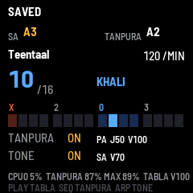

# TeenTaal-FM1

**An Indian classical music practice firmware for the M-VAVE FM-1 pocket synth**: a tanpura, tabla that play ten
taals, and a reference tone for intonation. Made for practising with a bansuri (or voice, or any instrument): sober,
one screen, no menus to dig through.

By **ElectroNick** — <https://github.com/ELENICK97>

> [!WARNING]
> **This firmware was generated with AI and has not been tested on a real FM-1 yet.** It was written by an AI coding
> assistant (Claude, by Anthropic) under ElectroNick's direction, and has been tested only in emulators. Installing any
> unofficial firmware can leave an FM-1 unable to start. **Use it at your own risk.** Read the
> [Disclaimer](#disclaimer) before installing.

**Status: version 1.0, still to be fully tested.** Every feature works in the emulators; nothing has been checked on
the device yet (CPU load, speaker sound, real flash timings). Updates are likely in the near future: watch the
repository or check the [Releases](https://github.com/ELENICK97/TeenTaal-FM1/releases).

## What it does

- **Tanpura** — a physical model of the instrument (after van Walstijn, Bridges and Mehes, DAFx-16): four strings
  (first string on Pa, Ma, Ni or any swara; two Sa; kharaj), the **jawari** buzz modelled from the string's contact
  with the bridge, the slow swell of the body, a plucking cycle with a human irregularity. Sa tunable in cents, A
  reference 415–466 Hz, fine tuning of every string.
- **Tabla** — recorded strokes (dayan tuned to your Sa, bayan at its own pitch), played by a **taal engine** with ten
  taals: Teentaal, Ektaal, Jhaptaal, Rupak, Keherwa, Dadra, Jhoomra, Deepchandi, Dhamar, Chautaal. Tempo from 20 to
  600 matras a minute, changed without jumps; the screen shows the matra, **sam (X)** and **khali (0)**. New taals
  can be added by writing a small text file ([data/taal/FORMAT.md](data/taal/FORMAT.md)).
- **Reference tone** — a clean sine on any swara, in three octaves; hold a key to hear its swara, like an harmonium.
- **Settings saved** with the SAVE button; the FM-1 starts silent.

Listen: [docs/audio/](docs/audio/) has short recordings made by the firmware's own audio code.

## Documentation

| Document | What it is |
|---|---|
| [INSTALL.md](INSTALL.md) | how to install it, and how to go back to the official firmware |
| [docs/MANUAL.md](docs/MANUAL.md) | the user manual: screen, controls, settings |
| [docs/DEVELOPMENT.md](docs/DEVELOPMENT.md) | how it is built: architecture, the sound engines, tests, measurements, known limits |
| [CREDITS.md](CREDITS.md) | who made what: the base firmware, the tabla samples, the tanpura paper, the theka sources |
| Italian | [INSTALL.it.md](INSTALL.it.md), [docs/MANUAL.it.md](docs/MANUAL.it.md), [docs/CONTROLS.it.md](docs/CONTROLS.it.md), and the development logs [PROGRESS.md](PROGRESS.md), [DECISIONS.md](DECISIONS.md), [CLAUDE.md](CLAUDE.md) (the instructions the AI followed) |

## Quick start

1. Read the [Disclaimer](#disclaimer) and [INSTALL.md](INSTALL.md); keep the official V15 firmware at hand.
2. Install the firmware (the package is in the [Releases](https://github.com/ELENICK97/TeenTaal-FM1/releases)).
3. On the FM-1: **SEQ** starts the tanpura, **PLAY** the tabla, **ARP** the reference tone. **SEL + a key** sets your
   Sa (default A3, for a bansuri in A); **SELECT** picks the taal, **KNOB1** the tempo. More in the
   [manual](docs/MANUAL.md).

To try it without an FM-1, build and run the browser emulator from the source (see
[docs/DEVELOPMENT.md](docs/DEVELOPMENT.md)).

## Licence and credit

TeenTaal-FM1 is open source under the [Apache License 2.0](LICENSE). You may use, change and share it, also in your
own projects, as long as you **keep the [NOTICE](NOTICE) file and credit ElectroNick, linking this repository:
<https://github.com/ELENICK97/TeenTaal-FM1>** ([CITATION.cff](CITATION.cff) gives the citation).

It is built on **fm1-base** by Charles Vestal and **felucca-bsp** by Leo Kuroshita (MPL-2.0, in `platform/`), uses
the tabla recordings of the Freesound pack *"tabla bols"* by **mmiron** (CC0), and its tanpura follows the paper by
**M. van Walstijn, J. Bridges and S. Mehes**, *A Real-Time Synthesis Oriented Tanpura Model*, DAFx-16 (2016). Details
and the other sources: [CREDITS.md](CREDITS.md).

## Disclaimer

- **AI-generated.** The code, data processing and documents were produced by an AI coding assistant (Claude, by
  Anthropic), under the direction and review of ElectroNick, who knows how to write and read firmware. Even so,
  AI-written code can contain mistakes that the tests did not catch.
- **Not tested on hardware.** Every package was run in emulators (fm1-emu and the fm1-base browser emulator), which do
  not reproduce the FM-1 exactly. The first installation on a real device is also its first real test.
- **Risk to your device.** The FM-1 has a single flash bank and no debug port. A failed or interrupted update, a
  power loss during the write, or a firmware bug at start-up can leave it unable to start; recovering it may need a
  hardware adapter. Installing an unofficial firmware may also void your warranty, and erases what other firmwares saved.
- **No warranty, no liability.** This software is provided "AS IS", without warranty of any kind, express or implied
  (Apache License 2.0, sections 7 and 8). The authors are not liable for any damage to your device, data or anything
  else arising from its use. **You install and use it entirely at your own risk.**
- **Hearing.** Check the volume (MASTER) before you start, especially with headphones.
- **Not affiliated** with M-VAVE. M-VAVE and FM-1 are trademarks of their owners. The tabla thekas follow published
  sources; schools differ, and nothing here is a teaching authority.
- **Updates.** Version 1.0 is a first release. Expect fixes and changes; feedback from tests on real FM-1s is welcome
  through the repository's Issues.
